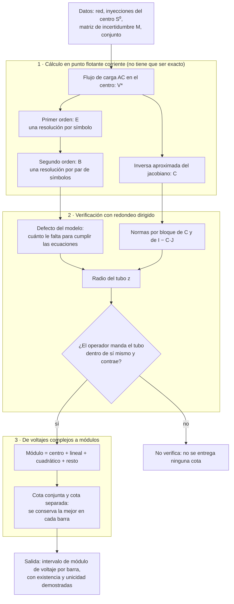

# METODO.md — El encierro verificado de voltajes: qué es, para qué sirve y cómo funciona

Este documento explica el método al que llegó el trabajo: qué problema resuelve, qué garantiza, cómo procede
paso a paso y dónde está cada pieza en el código. Las cifras vienen de [RESULTS.md](RESULTS.md), sección 26. El
historial de cómo se llegó aquí está en [CAMBIOS.md](CAMBIOS.md).

---

## 1. En una página

**El problema.** En una red de distribución las inyecciones de potencia no se conocen con exactitud: la demanda
varía y la generación con inversores puede estar en cualquier punto de su rango. Se quiere saber, para cada
barra, entre qué valores puede quedar el módulo del voltaje, con la certeza de que ningún caso posible queda
fuera.

**Lo que hace el método.** Entrega, para cada barra, un intervalo [lo, hi] y una demostración hecha por el
computador de que, para toda combinación admisible de inyecciones, el flujo de potencia AC tiene una solución
cuyo voltaje en esa barra cae dentro del intervalo.

**Cómo lo hace, en tres ideas:**

1. **Un modelo de segundo orden.** El voltaje de cada barra se aproxima por un polinomio de grado 2 en los
   símbolos de incertidumbre. Su error es de tercer orden, es decir, muy chico.
2. **Un tubo verificado alrededor del modelo.** Con un argumento de punto fijo se demuestra que la solución
   verdadera está a una distancia a lo más z del modelo, y que es la única ahí. Todo se evalúa con el redondeo
   controlado, así que la demostración vale en punto flotante.
3. **Una cota conjunta.** Al pasar del polinomio al intervalo, los términos de primer y segundo orden se acotan
   juntos y no cada uno por su lado, que es donde antes se perdía casi todo el ajuste.

**Qué tan bueno es.** En 78 de los 80 casos de prueba el intervalo mide a lo más entre 1,0000 y 1,12 veces el
rango exacto del voltaje, y a lo más 1,011 veces cuando la capacidad incierta es de hasta 20 %. Frente al mejor
método intervalar que se pudo armar como referencia (Krawczyk), su exceso sobre el rango exacto es entre 4 y 225
veces menor.

---

## 2. Objetivos

Lo que se le pidió al método, en orden de importancia:

1. **Garantía.** Que el intervalo contenga la solución AC para todo punto del conjunto de incertidumbre, no para
   una muestra. Un Monte Carlo no puede dar eso.
2. **Que la garantía valga en el computador.** Una demostración que supone aritmética exacta se cae con el primer
   error de redondeo. Aquí el redondeo se controla.
3. **Ajuste.** Que el intervalo no sea mucho más ancho que el rango real. Una cota garantizada pero al doble del
   rango sirve de poco para operar.
4. **Que el ajuste se pueda demostrar, no solo medir.** Saber cuánto sobreestima, contra una referencia que
   también tenga garantía.
5. **Cualquier topología.** Redes radiales, malladas y con elementos en derivación. El mejor método publicado
   para redes radiales no se extiende a las demás.
6. **Costo razonable** en redes de cientos a miles de barras.

Lo que no era objetivo: probabilidades. El método es de peor caso; no dice qué tan probable es cada voltaje.

---

## 3. Qué entrega y qué garantiza

### 3.1 Entrada

- La red: matriz de admitancias, barra de referencia y barras PQ.
- Las inyecciones, como función afín de K símbolos de ruido, igual que en aritmética afín:

```
S(ε) = S⁰ + M·ε,        ε ∈ [−1, 1]^K
```

  S⁰ es el centro y cada columna de M dice cuánto cambia la inyección de cada barra por unidad de un símbolo.
  Un símbolo puede mover una sola barra (una fuente) o muchas a la vez (la demanda de una zona).
- El conjunto de incertidumbre: la caja completa, o un producto de semidiscos inscritos en ella (sección 5.1).

### 3.2 Salida

- `lo`, `hi`: cota inferior y superior de |V| en cada barra PQ.
- `verified`: la verificación tuvo éxito y las cotas valen.
- `unique`: además se demostró unicidad.
- `s_abs`: el radio z del tubo en cada barra.

Si la verificación falla, el método **no entrega ninguna cota**. No hay modo aproximado de respaldo.

### 3.3 El enunciado

Para los datos de la red tal como están guardados, y para todo ε del conjunto:

1. existe una solución V(ε) del flujo de potencia AC con |V_j(ε) − m_j(ε)| ≤ z_j en cada barra j, donde m es el
   modelo de segundo orden;
2. es la única solución dentro de ese tubo;
3. lo_j ≤ |V_j(ε)| ≤ hi_j.

### 3.4 Lo que no dice

- **Nada sobre otras ramas de solución.** El flujo de potencia puede tener soluciones de bajo voltaje lejos del
  punto de operación. El enunciado es sobre la que continúa a la solución del centro.
- **Los datos se toman como exactos.** La garantía es sobre las ecuaciones que definen los números guardados, no
  sobre la red física.
- **Supone aritmética IEEE-754** de doble precisión con redondeo al más cercano y operaciones básicas
  correctamente redondeadas. No usa una biblioteca de intervalos certificada.
- **Cargas de potencia constante.** Otros modelos de carga no están cubiertos.

---

## 4. Por qué funciona: la intuición

Un encierro tiene dos fuentes de anchura innecesaria: el modelo que se usa y la forma en que se acota.

Un método de primer orden (una forma afín más un resto) deja como resto todo el segundo orden, y ese resto hay
que acotarlo con valores absolutos, lo que es grueso. Aquí el segundo orden está **dentro** del modelo, calculado
exactamente, y lo que queda por acotar con valores absolutos es solo el tercer orden. Si la incertidumbre mueve
los voltajes 2 %, el tercer orden es del orden de 0,02³: unas pocas millonésimas.

Por eso el tubo es delgado. En el ejemplo de la sección 10 los intervalos miden cerca de 0,014 p.u. y el radio
del tubo es de 2·10⁻⁶ p.u. La verificación no tiene que ser ingeniosa: solo tiene que demostrar que un tubo muy
delgado contiene la solución.

La otra mitad es no desperdiciar ese modelo al convertirlo en un intervalo, que es lo que hace la cota conjunta
(sección 5.5).

---

## 5. El proceso, paso a paso

### 5.1 Paso 0: el conjunto de incertidumbre

Con demanda incierta por zonas, el conjunto es la caja ε ∈ [−1, 1]^K.

Con generación por inversores, cada fuente de capacidad C puede inyectar cualquier (Δp, Δq) con Δp ≥ 0 y
|Δp + jΔq| ≤ C: un semidisco. Se le asignan dos símbolos, que cubren el semidisco con su caja envolvente:

```
Δp = (C/2)·(1 + ε_p),     Δq = C·ε_q
```

El método trabaja sobre la caja, pero el término de primer orden se maximiza sobre el semidisco mismo, con una
fórmula cerrada, para no pagar las esquinas de la caja que no pertenecen al conjunto.

### 5.2 Paso 1: el centro

Se resuelve un flujo de potencia AC corriente (Newton) para las inyecciones del centro S⁰. Su solución V* es el
punto alrededor del cual se construye todo.

### 5.3 Paso 2: el modelo de segundo orden

En coordenadas rectangulares las ecuaciones del flujo de potencia son exactamente cuadráticas. Si x* es el
estado del centro y D su desviación,

```
g(x* + D) = g(x*) + J·D + q(D)
```

con J el jacobiano en x* y q la parte cuadrática. Igualando orden por orden:

```
primer orden:    J·D₁ = dS(ε)           da   D₁ = E·ε
segundo orden:   J·D₂ = −q(D₁)          da   D₂ = εᵀ·B·ε
```

Cada símbolo cuesta una resolución lineal con la misma factorización dispersa de J; el segundo orden cuesta una
por cada par de símbolos. El resultado es el modelo

```
m_j(ε) = V*_j + Σ_k E_jk·ε_k + Σ_k Σ_l B_jkl·ε_k·ε_l
```

Es una forma afín, como las de la aritmética afín, a la que se le agregó el término cuadrático completo.

Hasta aquí todo se calcula en punto flotante corriente. **Nada de esto tiene que ser exacto:** el paso siguiente
toma V*, E y B como datos y mide cuánto les falta para cumplir las ecuaciones.

### 5.4 Paso 3: el tubo verificado

**Las ecuaciones en forma de inyección de corriente.** Para una red con barras PQ,

```
F(V, ε) = Y·V + c − conj(S(ε)) / conj(V) = 0
```

donde c es la corriente que aporta la barra de referencia. La parte Y·V es lineal; toda la no linealidad está en
el último término, que depende solo del voltaje de la misma barra. Esa es la razón de usar esta forma: las
admitancias grandes de las ramas cortas quedan en la parte lineal, que se trata sin pérdida.

**El operador.** Se busca el resto s tal que m(ε) + s sea la solución. Con C una inversa aproximada del
jacobiano de F,

```
Φ(s) = s − C·F(m(ε) + s, ε)
```

Un punto fijo de Φ es un cero de F. Se demuestra que Φ manda un producto de discos {|s_j| ≤ z_j} dentro de sí
mismo. Para todo s en ese conjunto y todo ε,

```
|Φ(s)_i|  ≤  Σ_j R_ij·z_j  +  Σ_j T_ij·( φ_j + ω_j(z)·z_j )
```

| Símbolo | Qué acota |
|---|---|
| R_ij | El bloque (i, j) de I − C·J₀: cuánto le falta a C para ser la inversa. Es de nivel de redondeo |
| T_ij | El bloque (i, j) de C: cómo responde el voltaje de la barra i a un residuo en la barra j |
| φ_j | El **defecto del modelo**: cuánto le falta a m(ε) para cumplir las ecuaciones en la barra j, en el peor ε |
| ω_j(z) | Cuánto cambia la no linealidad de la barra j dentro del tubo |

Si el lado derecho es menor o igual que z_i para toda barra, el teorema de Brouwer da un punto fijo: **existe**
una solución en el tubo. Si además la misma desigualdad se cumple con la constante de Lipschitz en lugar de ω,
Φ es una contracción y la solución es **única**.

**El defecto del modelo.** Multiplicado por conj(m), el defecto es un polinomio de grado 4 en ε:

| Grado | Contenido | Tratamiento |
|---|---|---|
| 0 | El residuo del flujo de carga del centro | Se evalúa con cota de error y se conserva |
| 1 | El residuo de las resoluciones de primer orden | Ídem |
| 2 | El residuo de las de segundo orden | Ídem |
| 3 y 4 | Lo que el modelo no captura | Se acota con las normas de los cambios de corriente Y·E e Y·B |

Con datos exactos los grados 0, 1 y 2 serían cero. No lo son por el redondeo, y por eso se miden en vez de
suponerse nulos: así entran en la cuenta el residuo del solver y el de cada resolución lineal.

**El radio.** Se itera z ← R·z + T·(φ + ω(z)·z) desde cero hasta que se asienta, se infla un poco el resultado y
se comprueba la desigualdad con todas las operaciones redondeadas hacia arriba.

### 5.5 Paso 4: de voltajes complejos a módulos

El módulo del voltaje verdadero difiere en a lo más z_j del módulo del modelo. Descomponiendo la desviación del
modelo en su componente a lo largo del voltaje del centro y a través de él,

```
|m_j(ε)| = |V*_j| + cᵀ·ε + εᵀ·H·ε + resto
```

donde c son las sensibilidades de primer orden del módulo, H es una matriz simétrica K × K por barra, y el resto
se acota en forma cerrada (es de tercer orden).

Queda acotar el rango de cᵀε + εᵀHε sobre el conjunto. Hay dos maneras y en cada barra se conserva la mejor:

**Cota separada.** El rango de cᵀε, exacto, más el rango de εᵀHε. Suma dos máximos que no ocurren en el mismo
punto: donde el término lineal es máximo, el cuadrático suele ser negativo. La diferencia es de segundo orden y
era casi todo el exceso del método.

**Cota conjunta.** Para cualquier vector u y cualquier número a,

```
−(uᵀε)² ≤ a² − 2a·(uᵀε)
```

porque una tangente queda por encima de una función cóncava. Se escribe H = H_resto − Σ_b u_b·u_bᵀ, con los u_b
tomados de los autovectores de autovalores negativos, y entonces

```
cᵀε + εᵀHε  ≤  máx (c − 2·Σ_b a_b·u_b)ᵀε  +  Σ_b a_b²  +  máx εᵀ·H_resto·ε
```

La parte cóncava de la forma se volvió lineal y se maximiza junto con cᵀε, de forma exacta sobre los semidiscos.
Los a_b se eligen en el máximo de la parte lineal y se refinan unas pocas veces. La cota inferior es la imagen
especular, con los autovalores positivos.

Ni los autovectores ni los a_b tienen que ser exactos: la desigualdad vale para cualquier u y cualquier a, y
H_resto se forma a partir de ellos con su cota de error.

### 5.6 Paso 5: el redondeo

Toda cota que entra en la demostración es una cota superior, en aritmética real, de la cantidad que dice acotar:

- Después de cada operación elemental el resultado se mueve al número de punto flotante siguiente en la
  dirección segura.
- Las sumas y los productos de matrices se corrigen con la cota a priori del error de una suma de n términos
  (Higham, 2002), que vale para cualquier orden de evaluación, así que no depende de cómo esté programada la
  biblioteca de álgebra lineal.
- Las cantidades con cancelación, como los defectos, se calculan en punto flotante y su error se acota a partir
  de las magnitudes de sus términos.

Las pruebas comparan estas cotas con aritmética racional exacta.

### 5.7 Salida

```
hi_j = |V*_j| + cota superior de (cᵀε + εᵀHε) + resto del módulo + z_j
lo_j = |V*_j| + cota inferior de (cᵀε + εᵀHε) − resto del módulo − z_j
```

con cada suma redondeada hacia fuera.

---

## 6. Diagrama



El diagrama se ve como figura en GitHub. Si el visor no lo dibuja, los pasos son los de la sección 5 en el mismo
orden.

---

## 7. Cómo se sabe que es ajustado

Medir el ancho contra un Monte Carlo no prueba nada: el Monte Carlo puede no haber encontrado los extremos. Se
usan dos referencias que también tienen garantía.

**Cota interior certificada.** Para cada barra se busca el punto del conjunto que más sube su voltaje y el que
más lo baja. Cada uno se verifica: se comprueba con aritmética racional que pertenece al conjunto, y se encierra
su solución con el mismo verificador, sin incertidumbre. Eso demuestra que el máximo exacto es al menos ese
valor. Queda:

```
lo  ≤  mínimo exacto  ≤  valor certificado      ···      valor certificado  ≤  máximo exacto  ≤  hi
```

El cociente entre (hi − lo) y la distancia entre los dos valores certificados es una **cota superior
demostrada** de cuánto sobreestima el encierro.

**Rango exacto por bisección.** En cajas con pocos símbolos se parte la caja en pedazos y se calcula el encierro
verificado de cada uno. La unión contiene al rango exacto y se acerca a él al refinar. Con los puntos
certificados por dentro, el rango exacto queda atrapado por los dos lados. Como el exceso de cada encierro es de
tercer orden en el tamaño del pedazo, bastan entre 1 y 69 pedazos para conocer el rango exacto con un error de
0,02 %.

Ningún punto certificado quedó fuera de un encierro. Son dos demostraciones independientes que no se
contradicen.

---

## 8. Variantes

**Barras de voltaje controlado.** La forma de inyección de corriente necesita barras PQ. Para barras PV hay una
segunda forma del operador que trabaja con el voltaje y la corriente de cada barra a la vez:

```
barra PQ:   conj(V_j)·I_j = conj(S_j)
barra PV:   Re(conj(V_j)·I_j) = P_j     y     |V_j|² = v_j²
```

Se acotan juntos el resto de voltaje y el de corriente. Funciona en distribución con fuentes de voltaje
controlado y en la red de transmisión de 30 barras; no en las de 118 y 300.

**Redes trifásicas desbalanceadas.** En el dominio de fases, con el neutro a tierra en cada barra y cargas de
potencia constante entre fase y neutro, cada nodo-fase cumple la misma ecuación que una barra monofásica. El
método se aplica entonces sin cambios, con la matriz de admitancias de fases y la fuente en 1∠0°, 1∠−120° y
1∠120°. Quedan fuera las cargas en delta y los transformadores.

---

## 9. Con qué se compara y qué resultados da

### 9.1 Los métodos de referencia

| Método | Qué es | Alcance |
|---|---|---|
| Sou, Khong y Sandberg (2026) | Flujo de carga de peor caso | Solo redes radiales sin elementos en derivación. Ahí es mejor y más barato que este método |
| Discos de Wang et al. (2018) | Un disco por barra a partir de una condición de existencia y unicidad | Cualquier topología, barras PQ |
| Krawczyk | Operador intervalar clásico; equivale a una forma afín de primer orden más un resto | Cualquier topología, barras PQ. Armado aquí en su versión más fuerte |

Dicho sin adorno, este método es Krawczyk un orden más arriba: modelo de segundo orden en vez de primero, resto
de tercer orden en vez de segundo.

### 9.2 Resultados principales

| Medida | Resultado |
|---|---|
| Casos en que verifica, con unicidad | 78 de 80 en ocho redes de distribución; 10 de 10 en la red trifásica |
| Ancho sobre el rango exacto, a lo más | 1,0000 a 1,12 (mediana por caso); peor barra 1,127; hasta 1,011 con capacidad incierta de hasta 20 % |
| Lo mismo en cajas con rango exacto conocido | 1,0000 a 1,0104 en 38 casos |
| Ancho de Krawczyk sobre el de este método | 1,003 a 1,34 |
| Exceso de Krawczyk sobre el de este método | 4 a 225 veces |
| Discos de Wang et al. | 1,24 a 2,17 veces el rango alcanzado |
| Pedazos para llegar a 1 % del rango exacto | Este método: 1. Krawczyk: 1 a 2.989, y no llega en 4 de 38 casos. Discos: no llegan en 31 de 38 |
| Tamaño | Hasta 2.940 barras con 64 símbolos y 533 barras con 108 |
| Tiempo | 81 ms de mediana; Krawczyk, 12 ms |
| Barras PV en distribución | Verifica en 30 de 30 casos; ajustado hasta 20 % de capacidad incierta |

El único par de casos en que no verifica es la red CIGRE de media tensión con 80 % de capacidad incierta.

---

## 10. Ejemplo de uso

El alimentador de 33 barras con sus cinco enlaces cerrados, cuatro fuentes con inversor, flujo inverso y 20 % de
capacidad incierta. Se corre desde la raíz del repositorio:

```python
import numpy as np
from cdhim import SecondOrder, load_grid
from cdhim.distflow import SCENARIOS, benchmark_ratings, net_injections
from cdhim.halfdisk import half_disk_study
from cdhim.verified import verified_enclosure


def close_ties(net):                       # los cinco enlaces: la red queda mallada
    net.line["in_service"] = True


g = load_grid("case33bw", prepare=close_ties)
sc = SCENARIOS["R"]                        # flujo inverso: demanda al 50 %, generación al 100 %
s0, cap = net_injections(g, benchmark_ratings(g), sc["rho_D"], sc["rho_G"], sc["pf"], rho_U=0.2)
so = SecondOrder(half_disk_study(g, s0, cap), 1.0)      # pasos 1 y 2: centro y modelo
enc = verified_enclosure(so, half_disks=True)           # pasos 3 a 5: tubo, módulos, redondeo

i = int(np.argmax(enc.hi - enc.lo))
print("verificado:", enc.verified, "| único:", enc.unique)
print(f"intervalo más ancho: barra {g.bus_label[g.pq[i]]}, |V| en [{enc.lo[i]:.6f}, {enc.hi[i]:.6f}] p.u.")
print(f"mayor radio del tubo: {enc.s_abs.max():.2e} p.u.")
```

Salida:

```
verificado: True | único: True
intervalo más ancho: barra 11, |V| en [1.012114, 1.025695] p.u.
mayor radio del tubo: 2.32e-06 p.u.
```

Son 8 símbolos y 32 barras PQ. En la tabla de resultados (`results/x12_verified.csv`, red «33 + ties», flujo R,
ρU = 20 %), este caso queda a 1,0003 veces el rango certificado; con la cota separada queda a 1,0022 y Krawczyk
a 1,0147. Los discos de Wang et al. quedan a 1,36 veces el rango alcanzado (`results/x8_feeders.csv`).

---

## 11. Costo y límites

**Dónde se va el tiempo**

| Etapa | Crece con | En la red de 2.940 barras con 64 símbolos |
|---|---|---|
| Modelo de segundo orden | Barras × K² | 3 s |
| Verificación del tubo | Matrices densas de 2m × 2m, m barras | 26 s |
| Módulos, acotando la forma término a término | Barras × K² | 12 s |
| Módulos, con RAA-K completa | Mucho más rápido con K | 199 s |

**Límites comprobados**

- **El número de símbolos.** La memoria crece como barras × K². Con 586 símbolos en la red de 2.940 barras un
  solo tensor ocupa 15 GB, y no se intentó.
- **Transmisión.** Con barras PV no verifica en redes de 118 barras o más. En la de 118 la parte lineal contrae
  y lo que falla es la cota; en la de 300 ni la parte lineal contrae.
- **Incertidumbre muy grande.** No verifica en la red CIGRE con 80 % de capacidad incierta, y con barras PV el
  ajuste se pierde desde 50 %.
- **Costo.** Es más caro que Krawczyk.
- **Modelo.** Cargas de potencia constante; en trifásico, solo estrella.

---

## 12. Relación con la aritmética afín del grupo

El modelo del paso 2 es una forma afín extendida: centro, un término lineal en los símbolos de ruido, un término
cuadrático completo y un término de error cuyo tamaño está demostrado. Lo que hace este método, visto desde la
aritmética afín, es calcular esa forma para la solución de un sistema no lineal y **verificar** su término de
error.

El término cuadrático εᵀHε es donde entran AF2, RAA y el teorema k-nomial: todos son maneras de acotar una forma
cuadrática sobre una caja. El operador RAA-K del grupo está dentro del método (`cdhim/knomial.py`, un port
validado contra los casos de prueba de `ibex-lib`) y se usa en la cota separada.

Dos cosas que hay que decir tal cual:

- **Con la cota conjunta, RAA-K dejó de aportar al ancho.** En los 80 casos de escala el intervalo es idéntico
  con RAA-K completa que acotando la forma término a término, y RAA-K cuesta hasta 216 s. Una explicación
  coherente con esto, que no se midió por separado: el operador ayudaba en la cota superior, que ahora sale de
  la cota conjunta, y para una forma cóncava su cota inferior coincide con la de término a término.
- **La estructura sí es la del grupo.** La cota conjunta descompone la forma en bloques (uᵀε)², como el teorema
  k-nomial, y los acota junto con el término lineal en vez de uno por uno. Usar ahí los bloques de RAA-K en
  lugar de autovectores no se ha probado, y es la manera natural de que el teorema siga dentro del método.

De ahí sale la decisión pendiente sobre el enfoque del paper, que está en la sección 11 de
[CAMBIOS.md](CAMBIOS.md).

---

## 13. Dónde está cada cosa

| Paso | Función | Archivo |
|---|---|---|
| Conjunto en semidiscos | `half_disk_study`, `first_order_range` | `cdhim/halfdisk.py` |
| Centro y primer orden | `custom_study`, `SecondOrder` | `cdhim/study.py`, `cdhim/second_order.py` |
| Segundo orden | `state_forms` | `cdhim/enclosure.py` |
| Tubo verificado | `verify_tube` | `cdhim/verified.py` |
| Cota conjunta | `joint_range` | `cdhim/verified.py` |
| Cota de la forma cuadrática por bloques | `raak_range`, `knomial_rewrite` | `cdhim/verified.py`, `cdhim/knomial.py` |
| Módulos y salida | `magnitude_bounds`, `verified_enclosure` | `cdhim/verified.py` |
| Barras PV | `verify_tube_vi`, `verified_enclosure_vi` | `cdhim/verified_vi.py` |
| Puntos certificados y bisección | `certify_points`, `box_bracket` | `cdhim/certified.py` |
| Redes trifásicas | `from_pandapower` | `cdhim/threephase.py` |
| Referencias | `worst_case_load_flow`, `disc_bound`, `Krawczyk` | `cdhim/distflow.py`, `cdhim/discs.py`, `cdhim/krawczyk.py` |

La derivación completa de cada cota, con sus constantes, está en el docstring del módulo correspondiente. Las
pruebas que la respaldan están en `tests/test_verified.py`, `tests/test_verified_vi.py` y
`tests/test_certified.py`.

---

## 14. Referencias

- N. J. Higham, *Accuracy and Stability of Numerical Algorithms*, 2.ª ed., SIAM, 2002. Cotas a priori del error
  de sumas y productos.
- R. Krawczyk, "Newton-Algorithmen zur Bestimmung von Nullstellen mit Fehlerschranken", *Computing* 4, 1969.
- K. C. Sou, S. Z. Khong y H. Sandberg, flujo de carga de peor caso en distribución radial, *IEEE Trans. Power
  Systems* 41(1), 2026.
- C. Wang, A. Bernstein, J.-Y. Le Boudec y M. Paolone, "Explicit conditions on existence and uniqueness of
  load-flow solutions in distribution networks", *IEEE Trans. Smart Grid* 9(2), 2018.
- C. Wang, J.-Y. Le Boudec y M. Paolone, "Controlling the electrical state via uncertain power injections in
  three-phase distribution networks", *IEEE Trans. Smart Grid* 10(2), 2019. **No se pudo leer completo.**
- H. M. Rodrigues Junior, I. D. Melo y E. G. Nepomuceno, flujo de potencia intervalar trifásico por inyección
  de corrientes, *Int. J. Electrical Power & Energy Systems* 139, 2022.

La lista completa, con el nivel de lectura de cada fuente, está en [RELATED_WORK.md](RELATED_WORK.md).
